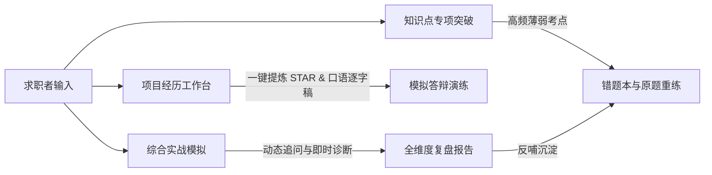

# Interview Tool 🎯

> **面向技术求职者的本地优先（Local-First）AI 模拟面试与经历复盘助手**  
> 告别机械的题库死记硬背与模板化套话，像真实大厂面试官一样针对项目难点层层追问，助你提炼真正有说服力的技术表达。

---

## ✨ 核心特色

- 🧠 **真·面试官级追问（拒绝车轱辘话）**  
  内置工作记忆与即时诊断（Working Diagnostics）机制。面试官能精准捕捉你回答中的亮点与盲区，顺着你的架构和排障经历逐层深挖，绝不重复提问已验证的技术考点。
- 🌟 **STAR 项目经历提炼 & 口语演练**  
  只需粘贴零散的工作笔记或项目描述，AI 自动提炼为规范的 **STAR（情境-任务-行动-结果）** 结构，并生成一段口语自然、可直接背诵练习的 **2~3 分钟口述逐字稿**。
- 🎯 **模块化专项突破与综合实战**  
  既支持 5~10 分钟的「知识考点速练」，也支持 30~45 分钟覆盖技术广度与深度的「多轮综合面试」；面试结束后即刻生成涵盖考点覆盖率、回答亮点与短板剖析的详尽复盘报告。
- 🔒 **本地优先与绝对隐私**  
  基于 SQLite 单文件存储，应用默认严格监听本地回环地址（`127.0.0.1`）。你的简历、个人工作经历与面试录音均留在你的设备上，零第三方数据上传。
- 🔌 **全主流大模型开箱即用**  
  原生支持 DeepSeek、OpenAI、Ollama 本地模型以及任意兼容 OpenAI 协议的自建 API 端点。

---

## ⚡️ 3 分钟快速上手

### 环境要求
- **Java**: 21+
- **Node.js**: 22+ (推荐 LTS)
- **Maven**: 3.9+ (或直接使用项目内置的 `./mvnw`)

### 1. 配置模型密钥
在项目根目录创建 `.env.local` 配置文件（已加入 `.gitignore`，安全不泄露）：

```bash
# 复制示例或直接新建 .env.local
touch .env.local
```

填入你的大模型 API 配置（以 DeepSeek 为例）：
```bash
# DeepSeek API 配置示例
INTERVIEW_MODEL_API_KEY="sk-xxxxxxxxxxxxxxxxxxxxxxxx"
INTERVIEW_MODEL_BASE_URL="https://api.deepseek.com/v1"
INTERVIEW_MODEL_NAME="deepseek-chat"
```

> 💡 **无需 API 密钥也能体验？**  
> 如果未提供任何 Key，后端将自动降级为安全的本地 Mock 模式，供你快速跑通全部界面与流程交互。

### 2. 一键启动前后端
直接在项目根目录下执行集成启动脚本：

```bash
./scripts/dev.sh
```

脚本将同时拉起 Spring Boot 后端与 Vite 前端：
- 🖥️ **前端界面**：[http://localhost:5173](http://localhost:5173)
- ⚙️ **后端接口**：[http://127.0.0.1:8080](http://127.0.0.1:8080)
- 🩺 **健康检查**：[http://127.0.0.1:8080/actuator/health](http://127.0.0.1:8080/actuator/health)

---

## ⚙️ 模型配置与参数速查

在 `.env.local` 中可灵活调整各类模型供应商及高级参数：

| 环境变量 | 默认值 | 说明 |
| :--- | :--- | :--- |
| `INTERVIEW_MODEL_BASE_URL` | `https://api.openai.com/v1` | 模型 API 端点（支持 OpenAI、DeepSeek、SiliconFlow 等） |
| `INTERVIEW_MODEL_API_KEY` | *(空)* | 模型服务商的 API 密钥 |
| `INTERVIEW_MODEL_NAME` | `gpt-4o` | 所调用的具体模型代号（如 `deepseek-chat`, `gpt-4o`） |
| `INTERVIEW_MODEL_CONNECT_TIMEOUT_SECONDS` | `10` | 建立连接超时时间（秒） |
| `INTERVIEW_MODEL_READ_TIMEOUT_SECONDS` | `120` | 等待模型完整生成的超时时间（针对长推理模型建议加大） |
| `INTERVIEW_MODEL_REASONING_EFFORT` | `low` | 推理强度设置（针对 o1/o3/r1 类模型：`low` / `medium` / `high`） |

---

## 🧭 功能模块概览



1. **项目经历（STAR 工作台）**  
   - 输入你做过的系统重构、性能优化或业务交付经历。
   - 点击「AI 一键生成 STAR」，自动划分背景、任务、行动与量化收益，并产出口语演练脚本，随时开始模拟答辩。
2. **综合面试（Mock Interview）**  
   - 沉浸式模拟真实面试流程，支持文字与语音输入。
   - 面试官具备短期记忆与考点树，回答过浅会刨根问底，回答充分则切换维度。
3. **专项训练与原题重练**  
   - 按技术板块定向刷题（并发编程、JVM、MySQL、微服务、分布式等）。
   - 错题自动归档，支持一键针对薄弱点再次发起针对性回练。
4. **复盘分析**  
   - 结构化回顾整场面试的问答时间线，查看每一轮的表现诊断、能力得分与进阶回答建议。

---

## 🛠️ 开发与测试指令

项目遵循极简高效的工程规范，封装了统一的脚本入口：

```bash
# 运行前后端完整测试套件（单测 + 契约回归）
./scripts/test.sh

# 仅测试前端（Vitest）
cd frontend && npm test

# 仅测试后端（JUnit 5）
cd backend && ./mvnw test

# 端到端自动化验收
bash scripts/e2e.sh
```

---

## 📂 仓库代码组织

```text
interview-tool/
├── backend/                  # Java 21 / Spring Boot 3 单体后端服务
│   ├── src/main/java/       # 核心业务逻辑（Controller / Service / LLM 适配器）
│   ├── src/main/resources/  # SQLite Schema、系统 Prompt 与考点题单
│   └── pom.xml
├── frontend/                 # Vue 3 / TypeScript / Vite / Tailwind 前端
│   ├── src/pages/           # 页面路由（面试室、经历管理、专项题库、复盘报告）
│   ├── src/components/      # 通用 UI 组件与音视频输入模块
│   └── package.json
├── data/                     # 本地 SQLite 数据持久化目录（自动生成）
├── scripts/                  # 统一启动、构建与质量检查脚本
└── docs/                     # 架构方案与详细技术设计归档
```

---

## 🔒 隐私与本地数据说明

- **数据不出机**：面试问答历史、个人简历与项目故事均保存在本地 `data/*.db`（SQLite 文件中），不依赖任何远程数据库服务。
- **回环网络隔离**：开发与测试服务仅监听 `127.0.0.1`，杜绝未授权的局域网跨源访问风险。
- **敏感信息保护**：`.env.local` 与本地私有题库已被全局忽略，绝不意外提交至公共仓库。
