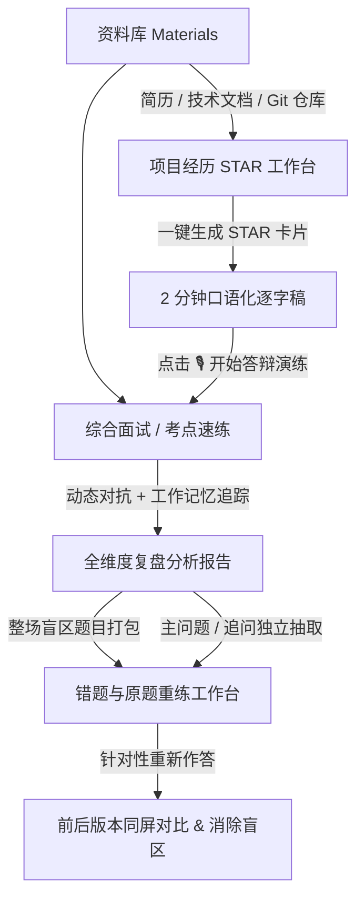

<div align="center">

# Interview Tool 🎯

**面向技术求职者的本地优先（Local-First）AI 模拟面试与经历复盘助手**

告别机械死记硬背与套壳 AI 的车轱辘话，像大厂面试官一样针对技术难点层层深挖，助你提炼真正有说服力的技术表达。

[](https://github.com/sz-xiaohuolong/interview-tool/releases)
[](https://www.oracle.com/java/)
[](https://spring.io/projects/spring-boot)
[](https://vuejs.org/)
[](./LICENSE)
[](https://www.sqlite.org/)

[快速开始](#-3-分钟快速上手) • [核心特性](#-核心特性矩阵) • [功能全景](#-业务全景流程) • [参数配置](#️-模型与环境配置) • [路线图](#️-版本路线图-roadmap)

</div>

---

## 💡 为什么选择 Interview Tool？

市面上的面试刷题软件层出不穷，但几乎都无法还原真实大厂面试的临场对抗感：

| 维度 | 传统题库刷题 | 普通 AI 套壳工具 | **Interview Tool (本项目)** |
| :--- | :--- | :--- | :--- |
| **提问方式** | 静态单向看解析，死记硬背 | 单轮一问一答，缺少深度追问 | **具备工作记忆诊断，顺着回答逐层深挖** |
| **对话体验** | 无互动 | 容易陷入“车轱辘话”和无脑重复 | **动态维护考点树与技术盲区，绝不重复追问** |
| **项目挖掘** | 无法关联个人真实项目 | 泛泛而谈，无法落实细节 | **支持挂载真实简历与代码仓，针对技术栈攻防** |
| **项目经历提炼** | 无辅助 | 仅给套话模板 | **一键生成标准 STAR 经历卡与 2 分钟口述逐字稿** |
| **复盘反哺** | 看完即忘，无法沉淀 | 仅给笼统分数 | **报告直接切片提取错题与追问，进入原题重练工作台** |
| **隐私安全** | 简历和数据上传云端 | 数据可能用于模型训练 | **100% 本地优先，SQLite 本地单文件存储，网络隔离** |

---

## ✨ 核心特性矩阵

### 🧠 1. 真·工作记忆诊断（Working Diagnostics）
- **绝无车轱辘话**：面试官动态感知已覆盖的技术要点（`coveredPoints`）与回答盲区（`gap`）。
- **层层递进的对抗感**：回答过浅会被刨根问底、追问底层实现；回答扎实则自然切换至下一技术维度。
- **高韧性防护**：即使遇到长思考模型响应过长，内置严格的截止时间与兜底降级策略，保证面试不卡顿。

### 🌟 2. STAR 项目经历提炼 & 口述答辩演练
- **素材一秒变经历**：粘贴杂乱的工作日志或需求笔记，AI 自动梳理为标准的 **STAR（情境-任务-行动-结果）** 结构化卡片。
- **2~3 分钟口述逐字稿**：直接生成通俗、口语化、可背诵的面试答辩范本。
- **一键发起答辩演练**：点击卡片底部的「开始模拟答辩演练」，立即生成该经历的专属追问对练。

### 🎯 3. 一体化错题与原题重练工作台（One-Stop Workbench）
- **细粒度题目切片**：面试复盘报告中，**主问题与每一轮深挖追问**均可被单独提取为练习题。
- **错题一键收录**：整场面试中识别出“回答错误、遗漏、不确定”的题目一键打包入库。
- **同题版本对比**：同一道题支持多次重新作答，系统提供左右同屏对比（Comparison），直观见证技术表达的进阶。

### 📚 4. 全能技术资料库（Evidence Base）
- **多模态凭据挂载**：支持录入个人简历、系统架构说明、性能优化方案。
- **本地 Git 仓库关联**：深度绑定本地项目源码，面试官可以直接针对你的真实提交和核心模块代码展开拷打。

### 🔒 5. 本地优先与绝对隐私保护
- **数据完全离线化**：所有面试对话、录音听写文本、项目草稿均保存在本地 `data/*.db`（SQLite 文件）中。
- **回环网络保护**：服务默认严格绑定 `127.0.0.1`，零跨源风险，无云端数据泄露隐患。

---

## 🧭 业务全景流程



---

## ⚡️ 3 分钟快速上手

### 运行环境要求
- **Java**: `21+` (推荐 Eclipse Temurin 或 Amazon Corretto)
- **Node.js**: `22+` (推荐 LTS)
- **Maven**: `3.9+` (后端已提供标准构建支持)

### 第 1 步：克隆代码与配置环境变量
```bash
git clone https://github.com/sz-xiaohuolong/interview-tool.git
cd interview-tool

# 创建本地配置文件（已在 .gitignore 中，安全不外泄）
touch .env.local
```

在 `.env.local` 中填入你的大模型 API 配置（以 **DeepSeek** 为例）：
```bash
INTERVIEW_MODEL_BASE_URL="https://api.deepseek.com/v1"
INTERVIEW_MODEL_API_KEY="sk-xxxxxxxxxxxxxxxxxxxxxxxx"
INTERVIEW_MODEL_NAME="deepseek-chat"
```

> 💡 **零成本体验？**  
> 如果未提供任何 Key，系统会自动启用安全的**本地 Mock 模式**，让你在不消耗 Token 的情况下完整体验全套交互流程。

### 第 2 步：一键运行前后端服务
```bash
./scripts/dev.sh
```

脚本将并行启动前端与后端：
- 🖥️ **前端用户界面**：[http://localhost:5173](http://localhost:5173)
- ⚙️ **后端 API 服务**：[http://127.0.0.1:8080](http://127.0.0.1:8080)
- 🩺 **系统状态检查**：[http://127.0.0.1:8080/api/training/status](http://127.0.0.1:8080/api/training/status)

---

## ⚙️ 模型与环境配置

项目原生支持任何兼容 OpenAI 协议的模型接口（OpenAI、DeepSeek、Moonshot、Ollama 本地大模型等）：

| 环境变量 | 默认值 | 详细说明 |
| :--- | :--- | :--- |
| `INTERVIEW_MODEL_BASE_URL` | `https://api.openai.com/v1` | 模型 API 端点地址 |
| `INTERVIEW_MODEL_API_KEY` | *(空)* | 模型服务商 API 密钥 |
| `INTERVIEW_MODEL_NAME` | `gpt-4o` | 所调用的主模型代号（如 `deepseek-chat`, `gpt-4o`） |
| `INTERVIEW_MODEL_REASONING_EFFORT` | `low` | 推理强度设置（针对 o1/o3/r1 等推理模型：`low` / `medium` / `high`） |
| `INTERVIEW_MODEL_CONNECT_TIMEOUT_SECONDS` | `10` | API 建立连接超时时长（秒） |
| `INTERVIEW_MODEL_READ_TIMEOUT_SECONDS` | `120` | 完整生成等待超时（长思考模型建议调整至 180~240） |

---

## 🛠️ 工程质量与开发者指南

项目注重高标准的工程质量与单一工程整洁性：

```bash
# 运行完整测试套件（后端 JUnit 406 项 + 前端 Vitest 327 项）
./scripts/test.sh

# 独立运行前端单元测试
cd frontend && npm test

# 独立构建前端生产环境包
cd frontend && npm run build

# 独立运行后端单元测试
mvn -f backend/pom.xml test
```

### 目录结构一览
```text
interview-tool/
├── backend/                  # Java 21 / Spring Boot 3 单体后端服务
│   ├── src/main/java/       # 业务逻辑（Controller、Service、LLM 适配、模型校验器）
│   ├── src/main/resources/  # SQLite Schema、系统 Prompt 与考点题单
│   └── pom.xml
├── frontend/                 # Vue 3 / TypeScript / Vite / Tailwind CSS
│   ├── src/pages/           # 页面路由（面试室、经历管理、专项题库、复盘报告）
│   ├── src/components/      # 核心 UI、音视频输入、材料详情抽屉
│   └── package.json
├── data/                     # 本地 SQLite 数据持久化目录（自动生成）
├── scripts/                  # 统一启动、打包与端到端回归脚本
└── docs/                     # 架构方案、设计图谱与历史演进归档
```

---

## 🗺️ 版本路线图 (Roadmap)

- [x] **v1.0.0 (Current)**
  - [x] 完整综合面试实战与动态深挖机制
  - [x] 短期工作记忆诊断（Working Diagnostics）与防车轱辘话设计
  - [x] 项目经历 STAR 提炼与 2 分钟口述逐字稿
  - [x] 一体化错题与原题重练工作台（支持切片重练与同题对比）
  - [x] 资料库卡片化与详情抽屉重构
  - [x] 本地优先 SQLite 数据持久化与隐私隔离
- [ ] **v2.0.0 (Planning)**
  - [ ] 高频经典题单考点深度映射（JavaBetter 等精选 60~100 题）
  - [ ] 实时双向全语音对话对练（WebRTC / 本地 TTS）
  - [ ] 面试数据包一键 Zip 导入与跨机迁移

---

## 📄 开源许可证

本项目基于 [MIT 许可证](./LICENSE) 开源。欢迎在求职备战中自由使用、修改与反馈！
