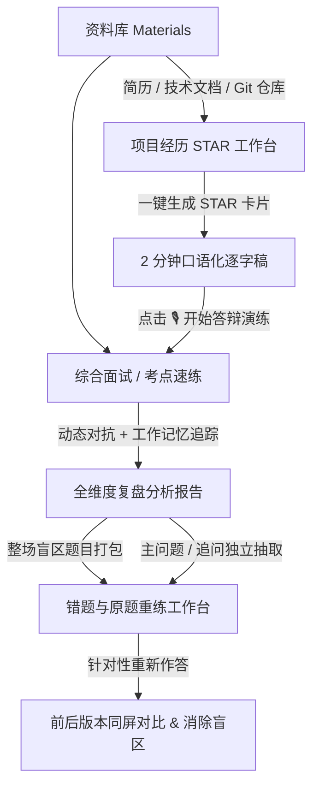

<div align="center">

# Interview Tool 🎯

**面向技术求职者的本地优先（Local-First）AI 模拟面试与经历复盘助手**

告别机械死记硬背与套壳 AI 的车轱辘话，像大厂面试官一样针对技术难点层层深挖，助你提炼真正有说服力的技术表达。

[](https://github.com/sz-xiaohuolong/interview-tool/releases)
[](https://www.oracle.com/java/)
[](https://spring.io/projects/spring-boot)
[](https://vuejs.org/)
[](./LICENSE)
[](https://www.sqlite.org/)

[快速开始](#-3-分钟快速上手) • [核心特性](#-核心特性矩阵) • [功能全景](#-业务全景流程) • [参数配置](#️-模型与环境配置) • [版本特性](#️-版本特性-release-features)

</div>

---

## 💡 为什么选择 Interview Tool？

市面上的面试刷题软件层出不穷，但几乎都无法还原真实大厂面试的临场对抗感：

| 维度 | 传统题库刷题 | 普通 AI 套壳工具 | **Interview Tool (本项目)** |
| :--- | :--- | :--- | :--- |
| **提问方式** | 静态单向看解析，死记硬背 | 单轮一问一答，缺少深度追问 | **具备工作记忆诊断，顺着回答逐层深挖** |
| **对话体验** | 无互动 | 容易陷入“车轱辘话”和无脑重复 | **动态维护考点树与技术盲区，绝不重复追问** |
| **项目挖掘** | 无法关联个人真实项目 | 泛泛而谈，无法落实细节 | **支持挂载真实简历与代码仓，针对技术栈攻防** |
| **项目经历提炼** | 无辅助 | 仅给套话模板 | **一键生成标准 STAR 经历卡与 2 分钟口述逐字稿** |
| **复盘反哺** | 看完即忘，无法沉淀 | 仅给笼统分数 | **报告直接切片提取错题与追问，进入原题重练工作台** |
| **隐私安全** | 简历和数据上传云端 | 数据可能用于模型训练 | **100% 本地优先，SQLite 本地单文件存储，网络隔离** |

---

## ✨ 核心特性矩阵

### 🧠 1. 真·工作记忆诊断（Working Diagnostics）
- **绝无车轱辘话**：面试官动态感知已覆盖的技术要点（`coveredPoints`）与回答盲区（`gap`）。
- **层层递进的对抗感**：回答过浅会被刨根问底、追问底层实现；回答扎实则自然切换至下一技术维度。
- **高韧性防护**：即使遇到长思考模型响应过长，内置严格的截止时间与兜底降级策略，保证面试不卡顿。

### 🌟 2. STAR 项目经历提炼 & 口述答辩演练
- **素材一秒变经历**：粘贴杂乱的工作日志或需求笔记，AI 自动梳理为标准的 **STAR（情境-任务-行动-结果）** 结构化卡片。
- **2~3 分钟口述逐字稿**：直接生成通俗、口语化、可背诵的面试答辩范本。
- **一键发起答辩演练**：点击卡片底部的「开始模拟答辩演练」，立即生成该经历的专属追问对练。

### 🎯 3. 一体化错题与原题重练工作台（One-Stop Workbench）
- **细粒度题目切片**：面试复盘报告中，**主问题与每一轮深挖追问**均可被单独提取为练习题。
- **错题一键收录**：整场面试中识别出“回答错误、遗漏、不确定”的题目一键打包入库。
- **同题版本对比**：同一道题支持多次重新作答，系统提供左右同屏对比（Comparison），直观见证技术表达的进阶。

### 📚 4. 全能技术资料库（Evidence Base）
- **多模态凭据挂载**：支持录入个人简历、系统架构说明、性能优化方案。
- **本地 Git 仓库关联**：深度绑定本地项目源码，面试官可以直接针对你的真实提交和核心模块代码展开拷打。

### 🔒 5. 本地优先与绝对隐私保护
- **数据完全离线化**：所有面试对话、录音听写文本、项目草稿均保存在本地 `data/*.db`（SQLite 文件）中。
- **回环网络保护**：服务默认严格绑定 `127.0.0.1`，零跨源风险，无云端数据泄露隐患。

---

## 🧭 业务全景流程



---

## ⚡️ 3 分钟快速上手

### 运行环境要求
- **Java**: `21+` (推荐 Eclipse Temurin 或 Amazon Corretto)
- **Node.js**: `22+` (推荐 LTS)
- **Maven**: `3.9+` (后端已提供标准构建支持)
- **Python**: `3.9+`（演示数据初始化和脚本检查，仅使用标准库）

### 第 1 步：克隆代码与配置环境变量
```bash
git clone https://github.com/sz-xiaohuolong/interview-tool.git
cd interview-tool

# 创建本地配置文件（已在 .gitignore 中，安全不外泄）
touch .env.local
```

在 `.env.local` 中填入你的大模型 API 配置（以 **DeepSeek** 为例）：
```bash
LLM_BASE_URL="https://api.deepseek.com/v1"
LLM_API_KEY="填写你的密钥"
LLM_MODEL="deepseek-chat"
```

也可以启动后在页面左下角的“模型配置”中填写。未配置密钥时会明确提示，系统不会自动切换为 Mock。仅查看已有资料与记录不调用模型。

### 第 2 步：一键运行前后端服务
```bash
./scripts/dev.sh
```

脚本将并行启动前端与后端：
- 🖥️ **前端用户界面**：[http://localhost:5173](http://localhost:5173)
- ⚙️ **后端 API 服务**：[http://127.0.0.1:8080](http://127.0.0.1:8080)
- 🩺 **系统状态检查**：[http://127.0.0.1:8080/api/training/status](http://127.0.0.1:8080/api/training/status)

### 截图与演示专用入口

```bash
./scripts/demo.sh
```

打开 [演示工作空间](http://127.0.0.1:5174)，后端固定使用 `8081`。可与日常 `5173/8080` 同时运行，仍使用同一套应用代码。页面会标明演示环境，浏览器草稿也按不同端口隔离。

首次启动自动准备 5 份虚构资料、2 份附件、3 场带问答和复盘的示例面试、2 份项目经历及 2 道重练题。预置报告与评分是人工编写的界面样例，未经真实模型评估；查看这些内容无需密钥，也不调用模型。

新建面试、生成评估仍使用真实模型，请在**演示页面**单独配置。演示启动不读取 `.env.local`，也不继承日常模型或 Spring 配置；数据库、上传文件、历史和模型设置都保存在 `.runtime/demo/data/`，不会复制日常 `data/` 中的内容。

按 `Ctrl+C` 停止演示，数据保留；下次启动保留修改与删除结果。端口被占用时直接退出，不自动切换端口。首次数据初始化拒绝覆盖非空、未登记的目录及符号链接。日志位于 `.runtime/demo/`，该目录不会提交到 Git。若需重新准备初始样例，先停止演示，将 `.runtime/demo/data/` 改名备份，再执行启动命令；原演示记录与模型配置保留在备份目录中。

---

## 求职管理

在左侧导航进入「求职管理」，点击「新增岗位」，填写公司和岗位后保存。状态默认「待投递」；点击「补充岗位与安排」可填写地点、平台、岗位链接、JD、岗位类型、投递日期、下次行动日期、面试时间及备注。保存后可以直接在表格中修改七种投递状态，点击公司／岗位查看完整详情，再通过「编辑岗位」修改全部业务内容。

「未归档／已归档／全部」只控制记录显示，归档不会更改投递状态；已归档列表可以恢复。公司搜索、状态筛选和日期排序可组合使用，未填写的日期排在最后。删除须二次确认。记录保存在现有本机 SQLite 中，重启保留，不需要配置模型。

### CSV 备份与导入

1. 点击「导出全部」备份所有岗位（包括已归档、ID 和时间），或下载「CSV 模板」填写新记录。
2. 保留全部中文表头及顺序，「格式」每行填 `投递记录-1`，公司和岗位必填。状态可填 TO_APPLY、APPLIED、ASSESSMENT、INTERVIEW、OFFER、REJECTED、WITHDRAWN；空值默认 TO_APPLY。岗位类型可填 CAMPUS、INTERNSHIP、SUMMER_INTERNSHIP、FULL_TIME、OTHER；空值默认 OTHER。
3. 日期使用 `YYYY-MM-DD`，面试时间使用带偏移的 ISO 时间，如 `2026-10-24T10:30:00+08:00`；归档为 true／false，留空为 false。新增记录 ID 和创建／修改时间可空，恢复备份时原样保留。
4. 文件使用 UTF-8，逗号、引号、多行文本按标准 CSV 转义。导出里「文本:」是可逆的公式保护前缀，导入会去掉一层；不要删除它。手工原文若本来以「文本:」开头，须再加一层前缀以保留原文。
5. 点击「导入 CSV」，先查看总数、新增、重复、冲突及逐行错误，再确认导入。有错误整批不写入；重复明确跳过，同 ID 不同内容不覆盖。每次最多 5 MiB、5000 条，超限备份保留表头拆分文件。预览 15 分钟内有效，文件、相关记录变化或服务重启后需重新预览。

求职管理处理手工投递记录，不自动投递、发送提醒或关联面试；独立的岗位搜索入口见下文。投递接口说明见 [当前技术设计](docs/vibe/TECH_DESIGN.md#12-求职管理与-csv-接口)，验收证据见 [V6 验证记录](docs/vibe/releases/v6/VERIFICATION.md)。

独立浏览器验收：`bash scripts/e2e-job-applications.sh`。该脚本使用临时测试库与独立构建输出，不读取日常 `.env.local`，不替换日常运行 JAR；使用已安装的 Chromium 和前端依赖。

## 岗位搜索

左侧「岗位搜索」提供「搜索职位／我的收藏」两个页签。输入关键词，选择城市和来源后主动搜索；当前目录支持深圳、北京、上海、广州、杭州、苏州、成都。BOSS、猎聘、智联分别返回进度，单站失败保留其他结果。首批每站最多20条，点击「加载更多」继续，每次搜索每站最多100条；筛选只作用于已获取结果。

点击岗位查看当前来源的正文与具体原链接。跨站只有完整同岗证据一致才分组，薪资、要求和正文始终按来源展示。收藏保存操作时已经取得的快照，后续读取不覆盖；取消收藏保留已存 JD。

在详情点击「保存 JD」，核对并编辑名称与正文后写入现有资料库。相同来源重复保存返回已有资料，不覆盖用户编辑；「查看已保存 JD」精确打开该资料。资料被删除后，可从仍保留的岗位或收藏重新保存。刷新或重进只恢复上次搜索条件，收藏和 JD 保留，临时结果不恢复。

### 开发者访问配置与验收边界

后端复用本机 Chrome 已获允许的 CDP WebSocket 及招聘登录态。默认读取 Chrome 的 `DevToolsActivePort`；非默认浏览器目录通过 `INTERVIEW_JOB_BROWSER_ACTIVE_PORT_FILE` 指向相应文件后重启后端。服务仅连接回环地址，不导出 Cookie，不自动开启远程调试或代办验证。登录恢复、安全验证和会话维护由开发者完成，普通用户无需提交凭据。

2026-10-24：模块代码已接通搜索、收藏和资料库；**当前真实三站产品链路尚未验收通过**。此前已取得三站真实样例，但本轮直接 CDP 握手超时，扩展读取也存在页面上下文限制。配置文件存在不代表当前会话可用；页面会明确显示来源不可用。具体软件检查、真实来源证据及剩余限制见 [V6 验证记录](docs/vibe/releases/v6/VERIFICATION.md)。

隔离验收运行 `bash scripts/e2e-job-search.sh`。脚本创建专用合成招聘浏览器、临时 SQLite 和独立构建，验证真实应用 HTTP、Vue、Java CDP 与持久化重启；所有招聘内容明确为合成，外网请求被阻止，不接触日常 Chrome、资料或模型。该检查不能替代真实平台验收。

## ⚙️ 模型与环境配置

项目原生支持任何兼容 OpenAI 协议的模型接口（OpenAI、DeepSeek、Moonshot、Ollama 本地大模型等）：

| 环境变量 | 默认值 | 详细说明 |
| :--- | :--- | :--- |
| `LLM_BASE_URL` | `https://api.openai.com/v1` | 模型 API 端点地址 |
| `LLM_API_KEY` | *(空)* | 模型服务商 API 密钥；缺少时明确提示 |
| `LLM_MODEL` | `gpt-4o-mini` | 主模型名称 |
| `LLM_REASONING_EFFORT` | *(空)* | 可选推理强度，由模型服务决定支持范围 |
| `LLM_TIMEOUT_SECONDS` | `60` | 共用模型请求超时（秒） |
| `DATA_DIR` | 仓库下 `data/` | 日常数据目录 |
| `PORT` / `WEB_PORT` | `8080` / `5173` | 日常后端与前端端口；演示脚本固定为 `8081` / `5174` |

环境变量作为启动配置；页面已保存的模型设置优先。演示脚本使用独立配置，不使用上述日常环境变量覆盖端口和目录。

---

## 🛠️ 工程质量与开发者指南

项目注重高标准的工程质量与单一工程整洁性：

```bash
# 运行完整测试套件（实际数量与结果见对应验证记录）
./scripts/test.sh

# 独立运行前端单元测试
cd frontend && npm test

# 独立构建前端生产环境包
cd frontend && npm run build

# 独立运行后端单元测试
mvn -f backend/pom.xml test
```

### 目录结构一览
```text
interview-tool/
├── backend/                  # Java 21 / Spring Boot 3 单体后端服务
│   ├── src/main/java/       # 业务逻辑（Controller、Service、LLM 适配、模型校验器）
│   ├── src/main/resources/  # SQLite Schema、系统 Prompt 与考点题单
│   └── pom.xml
├── frontend/                 # Vue 3 / TypeScript / Vite / Tailwind CSS
│   ├── src/pages/           # 页面路由（面试室、经历管理、专项题库、复盘报告）
│   ├── src/components/      # 核心 UI、音视频输入、材料详情抽屉
│   └── package.json
├── data/                     # 本地 SQLite 数据持久化目录（自动生成）
├── scripts/                  # 统一启动、打包与端到端回归脚本
└── docs/                     # 架构方案、设计图谱与历史演进归档
```

---

## 🗺️ 版本特性 (Release Features)

- [x] **v1.0.0 (Current)**
  - [x] 完整综合面试实战与动态深挖机制
  - [x] 短期工作记忆诊断（Working Diagnostics）与防车轱辘话设计
  - [x] 项目经历 STAR 提炼与 2 分钟口述逐字稿
  - [x] 一体化错题与原题重练工作台（支持切片重练与同题对比）
  - [x] 资料库卡片化与详情抽屉重构
  - [x] 本地优先 SQLite 数据持久化与隐私隔离
  - [x] 求职投递管理表格、归档、安排与完整 CSV 备份恢复

---

## 📄 开源许可证

本项目基于 [MIT 许可证](./LICENSE) 开源。欢迎在求职备战中自由使用、修改与反馈！
