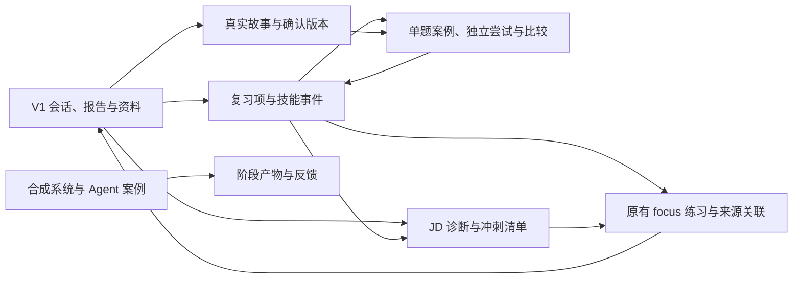

# V2 技术设计与实施对应

> **生效基线（2026-10-15）**：用户已批准四份 V2 文档及 REVIEW.md 推荐修改，D01～D08、R01～R04、D-T01、E1～E8 已采纳，并已授权实施。原有源码保持字节不变，功能通过新增文件接入。五项功能已实现，软件验证与真实模型质量分开记录，详见 [VERIFICATION.md](VERIFICATION.md)。当前正式交付仍为 V1；V2 开发与本轮验证已完成，待用户人工验收，整体证据为 PARTIAL。2026-10-16 用户已授权测试所需真实模型调用及提交、推送；用户随后明确授权原资料库备份、增量升级并统一在5173启用V2，已执行且旧记录保持；部署、PR、Tag和GitHub Release不在本次范围。


| 项目 | 状态 |
|---|---|
| 文档版本 / 日期 | V2 批准基线及实施记录 / 2026-10-15 |
| 设计 / 审核 | 已冻结 / 已批准（FROZEN / APPROVED） |
| 实现与验证 | 五项已实现；软件及六类固定任务真实校准已有适用证据；两次历史结构失败、修正及复验分开保留，待人工验收 |

本文保存已批准设计及实施对应。第 1 节是 V2 开工前的 V1 基线，第 11 节说明实际新增接入与取舍；实际架构同时登记在 [项目级技术架构](../../TECH_DESIGN.md)，验证结果见 [VERIFICATION.md](VERIFICATION.md)。

审核方案时，建议先读第 2 节的总体取舍、第 3 节的页面、第 8 节的迁移与回退、第 9 节的风险，再对照第 10 节检查需求覆盖。第 4～7 节提供数据、接口、状态和模型调用细节，供需要核对实现约束时查阅。

## 1. 设计依据与现有能力

对应 [SPEC.md](SPEC.md) 的 V2-REQ-01～V2-REQ-06；范围与 D01～D08 见 [PROJECT_BRIEF.md](PROJECT_BRIEF.md)。开工前静态核对基线为 `20fc7cfa51d7983a4ad766e14380d3437b4f5e8b`。以下表格描述当时的 V1；本次实现仅用合成临时库验证，未操作用户真实数据库。

| 现有实现 | 可复用部分 | 必须新增或局部扩展 |
|---|---|---|
| [InterviewService](../../../../backend/src/main/java/cn/interview/InterviewService.java)：QUICK/RESUME/PROJECT、原始 messages、context、pendingAction、reportStatus；回答有 requestId 与 expectedMessageId | 原有规划、追问、资料快照和报告；恢复方式作为模式参考 | 创建会话目前没有持久请求去重；需要为带 V2 来源的创建增加原子预留，不能说已有答案幂等已覆盖创建 |
| [Report.vue](../../../../frontend/src/pages/Report.vue) 传 focus/role/level 到 [Configure.vue](../../../../frontend/src/pages/Configure.vue) | 既有专项练习入口和配置表单 | 侧表保存训练来源；返回报告时确认新增证据 |
| 报告有 correct/incorrect/missing/uncertain，依据为整题字符串数组 | 原分类和原文，不重新推断历史 | 发现稳定 ID、标签、来源版本和用户异议；旧报告无法还原逐条因果引用 |
| [LlmClient](../../../../backend/src/main/java/cn/interview/LlmClient.java) 同步 HTTP、JSON 对象、temperature=0.4、reasoning_effort、显式 Mock、超时与错误映射 | 传输方式、配置、安全边界和现有调用方法 | V2 调用返回可用元数据，任务级输入输出限制；V1 数据里只有 mock 标记，不具有历史模型协议 |
| [ModelValidator](../../../../backend/src/main/java/cn/interview/ModelValidator.java) 校验枚举、长度、分数与引用子串 | 基础校验函数和失败语义 | 按明确 sourceId/版本/片段定位；新任务各自校验，不能只证明某字符串在混合上下文中出现 |
| [Store](../../../../backend/src/main/java/cn/interview/Store.java)：JdbcTemplate、事务、SQLite WAL、busy timeout；启动执行 schema.sql | 数据源、短事务和 JSON 快照存储 | 迁移版本台账、条件更新、幂等记录和 V2 专用读写；现有 synchronized 只保护单个服务实例 |
| [MaterialService](../../../../backend/src/main/java/cn/interview/MaterialService.java)：文件解析、24,000 字符提取、30,000 字符上下文、截断标识 | 上传与资料管理，不重写解析器 | 新任务的来源分段与实际发送范围；旧合并文本无法追补原文件版本 |
| [Session.vue](../../../../frontend/src/pages/Session.vue)：sessionStorage 草稿、重放待提交回答、轮询与多标签冲突提示 | 交互模式及现有公共组件 | 新资源独立草稿键与预期版本；不直接复制整页或给 V1 模式枚举塞入阶段训练 |

五类旧业务表的结构和旧 `Session.schemaVersion=1` 保持兼容。V1 验证记录属于此前代码与环境，不能用于宣布 V2 已通过。当前视觉重构提交与首次归档的前端摘要不同，沿用最新代码和 DESIGN 进行 V2 UI 回归。

## 2. 总体方案：复用什么，新增什么

保持单个 Spring Boot 进程、SQLite、本地文件和现有 Vue 应用。新增五个业务服务和少量共用工具；不引入队列、向量库、工作流平台、独立服务或新的模型供应商。



五个业务模块分别处理复习、单题练习、JD 诊断、故事和分阶段设计，实际命名为 `ReviewService`、`PracticeService`、`JdService`、`StoryService`、`DesignPracticeService`，共用 `V2Store`。Service 负责业务规则，Store 负责读写数据。

共用工具职责如下：`V2Operations` 防止本版操作重复保存结果，并记录重试代次；`V2InputPreparations` 整理本次发送的来源片段；`V2OutputValidator` 按任务检查模型输出。可按实际复杂度合并文件，不扩展成通用事件平台或流程引擎。

主要取舍：

- **保留旧会话，新增各功能专用记录**：同题答案和阶段产物的生命周期不同，独立保存，避免破坏 V1 mode、questionIndex 和追问上限。
- **常查字段建列，完整细节保存为带版本的 JSON**：为来源、状态、日期和唯一性建立列及索引；有限大小的结构与版本细节保存 JSON，沿用项目方式，不把每个模型句子拆成表。
- **每个业务对象保存自己使用的原文快照**：不新增全站文档索引或通用证据仓库；相同资料在不同案例中可以有独立快照，换取清晰的保留边界。
- **同步请求、持久状态、显式重试**：模型调用在数据库事务之外执行；前端可轮询资源，刷新不丢失状态。没有常驻任务队列或自动重试循环。

## 3. 页面与交互

继续使用 [DESIGN.md](../../../../DESIGN.md)、[style.css](../../../../frontend/src/style.css) 和 [.impeccable/design.json](../../../../.impeccable/design.json) 的 Tokens 与组件表现。新增功能页沿用 AppLayout，原四个导航入口保留，在原内容区增加五项训练导航；JD、故事和阶段训练可直接进入并从来源返回，不改造全站信息架构。

| 页面 / 入口 | 主要内容与操作 | 空态、错误与恢复 |
|---|---|---|
| `/reports/:id` 增量入口 | 每题整理复习；原问答选择具体问题重答；现有专项练习保留 | 非 READY 报告不能导入；旧记录标来源限制；导入失败不影响读报告 |
| `/review`、`/review/:id` | 到期、待确认、待补材料、完成/归档；原文与发现；标签、异议、调度 | 无项引导原面试；重复确认返回同项；失败练习保持 IN_PROGRESS，可继续或返回队列 |
| `/skills` | 标签下的接受/争议观察、用户自评与时间线 | 无标签数据不显示雷达分或虚构趋势；未归类单列 |
| `/practice/:caseId` | 当前题目和必要前文、草稿、提交、已提供解析标识 | 当前答案不可编辑；未评估可重试；离开保留本地草稿；旧版本冲突保留文本 |
| `/practice/:caseId` 内比较区 | 两次原答、协议条件、修正/遗漏/新增问题、双侧引用 | 默认隐藏分差；协议不兼容时只显示允许的原文视图；提供显式配对重评按钮 |
| `/jd-diagnostics/:id`、`/sprints/:id` | JD 原文、要求确认、材料列、训练列、最多 5 个行动项 | 空 JD 阻止生成；无材料和无训练分别显示；来源变化提示更新并保留旧结果 |
| `/stories`、`/stories/:id` | 两种表单、字段来源、待补充/确认、版本差异、练习入口 | 无资料可手填；生成失败保留手写内容；确认版改动新建版本；归档隐藏但不清除历史 |
| `/design-practice`、`/design-practice/:id` | 案例选择；阶段导航；当前结构化产物；反馈与未解决项；汇总 | 新阶段未解锁说明原因；失败重试当前版本；旧反馈 STALE 可查看，不能用于完成 |

复用 `Notice / EmptyState / LoadingState / Modal`、原生表单和 `details`。桌面原文比较双列，600px 以下上下排列；1440、390、320px 验收全文换行和操作可达。状态含文字，不仅依赖颜色；保留 Ctrl/⌘+Enter、输入法组合状态、焦点和 Esc 行为。新增页多行文本的普通 Enter 保持换行，原生按钮可用 Enter/Space 操作。阶段草稿保存后恢复原控件焦点，推进后聚焦新阶段首字段，结束后聚焦汇总；用户已移焦时不抢焦。同题草稿保存后恢复仍存在的原操作按钮。仅增加局部功能样式，不重写六个 V1 页面。

这些路由由新增 `frontend/src/v2/routes.ts` 注册，原 router 文件不改。DESIGN 的 V1 纯表现层约束不限制已批准的 V2 新增业务。比较显示集成在 `/practice/:id` 内，没有单独注册 compare 页面。

## 4. 数据怎样保存，如何保留来源

本节使用的术语如下。字段名、表名和枚举保留原拼写，便于实现时对照。

| 术语 | 含义 |
|---|---|
| 聚合 | 作为一个整体保存和更新的一组业务数据，例如一次单题尝试 |
| revision / expectedVersion | revision 是当前记录的修改版本；请求携带 expectedVersion，服务端只在版本一致时更新，防止旧页面覆盖新内容 |
| 快照 / SHA-256 | 快照保留当时原文；SHA-256 是内容摘要，用于识别内容是否改变，不代表内容本身正确 |
| 指纹 / 评分协议 | 指纹汇总题目、上下文和执行规则；评分协议记录规则、提示词版本、模型服务和实际参数，用于判断两次结果能否比较 |
| 幂等 / generation | 同一请求反复提交只保存一份有效结果；generation 是每次重试的代次，用于拒绝旧请求迟到的结果 |
| 侧表 / 外键 | 侧表新增关联，不改旧记录；外键约束表间引用，防止引用不存在的记录 |
| PK / FK / UNIQUE / CHECK / NULL | 分别表示主键、外键、唯一约束、条件约束和空值；NOT NULL 表示不能为空 |
| Tokens / DTO | Tokens 是统一视觉参数；DTO 是接口传给页面的数据对象，不包含完整内部对象 |

### 4.1 通用约定

新 ID 使用 UUID 文本；时间采用 UTC ISO-8601，前端本地化显示。可变聚合有 `revision INTEGER NOT NULL DEFAULT 0 CHECK(revision>=0)`；更新必须带 `expectedVersion`。有限 JSON 均带 `schemaVersion: 1`，服务端做字段校验，不依赖客户端类型。

`SourceSnapshot` 保存一次实际使用的来源文本，完整字段为 `snapshotId, sourceKind, sourceId|null, sourceVersion|null, text, sha256, capturedAt, truncated, includedRange`。

- 手填来源记为 USER_ASSERTION，旧合并资料记为 LEGACY_CONTEXT；缺少 documentId 或旧修订号时，不编造补齐。
- 内容摘要针对实际保存的 UTF-8 文本计算。多个字段合成指纹时，使用规范 JSON：对象键递归排序，数组保留原顺序。
- 文本归一化只用于识别重复请求；展示和引用始终保留原文。

`EvidenceRef` 指向一段可以核对的原文，字段为 `snapshotId, sha256, start, end, quote`。start/end 记录 UTF-16 编码位置，不能切断代理对，即不能把某些表情等字符的两段编码拆开。服务端核对 `text.substring(start,end)==quote`、内容摘要及读取该来源的权限。

模型结论另外保存 `conclusionType, evidenceRefs, assessmentProtocol, status`，不改原文。判断“未提及”时，关联检查点和被检查的全文范围，不制造不存在的“缺失句子”。

模型只需返回 snapshotId 和逐字 quote，偏移提示可选；最终摘要与偏移由服务端依据唯一匹配产生。若片段重复且无法唯一定位，不任取第一次出现作为证据，而是拒绝该引用或明确为未确认，不能进入支持确定结论的证据集合。

旧报告来源快照包含原 `sessionId/questionIndex`、该组完整问答、报告片段及其摘要。它只能支持整题出处；逐发现的归因精度不足必须保留。新模型结论可建立精确引用，但结构合法不意味着语义判断正确。

### 4.2 新增表的用途与完整约束

所有表均在审批后的迁移中创建。表内 `payload TEXT NOT NULL` 表示受服务端 schema 校验的 JSON；表的存在本身不证明功能已完成。

| 表 | 用途 |
|---|---|
| `v2_schema_migrations` | 记录已经执行的数据库迁移版本 |
| `v2_operations` | 记录一次生成或写入操作及其重试 |
| `v2_review_items` | 保存一道来源主问题的复习项 |
| `v2_skill_events` | 追加技能观察、确认、异议和自评事件 |
| `v2_practice_cases` | 冻结单题题目、前文、资料和初始规则 |
| `v2_practice_attempts` | 保存一次回答及评估 |
| `v2_practice_comparisons` | 保存两次回答的比较结果 |
| `v2_jd_diagnostics` | 保存一版 JD 要求与证据诊断 |
| `v2_sprints` | 保存短清单和行动历史 |
| `v2_stories` | 保存故事身份和当前版本 |
| `v2_story_versions` | 保存故事正文、来源及字段确认 |
| `v2_design_sessions` | 保存五阶段设计内容与反馈 |
| `v2_training_links` | 关联复习/JD 来源与原有专项练习 |

以下逐表列出完整技术约束，供实现和技术审核时查阅。

#### `v2_schema_migrations`：记录已经执行的数据库迁移版本

字段、约束和索引：`version INTEGER PRIMARY KEY, checksum TEXT NOT NULL, applied_at TEXT NOT NULL`。

写入职责与保留规则：维护模式写入；正常应用只检查，不在普通访问时迁移。

#### `v2_operations`：记录一次生成或写入操作及其重试

字段、约束和索引：`id PK, kind, resource_type, resource_id, request_id, input_hash, state, generation, expected_revision, payload, created_at, updated_at` 均非空；scope_key 非空；UNIQUE(kind,scope_key,request_id)；索引 state；枚举和非负代次约束。

写入职责与保留规则：仅本版操作；冻结输入引用、执行配置、错误及结果指针；不存密钥/原始 HTTP 响应。

#### `v2_review_items`：保存一道来源主问题的复习项

字段、约束和索引：`id PK, source_session_id FK sessions(id), question_index CHECK>=0, status, next_review_at NULL, revision, payload, created_at, updated_at`；UNIQUE(source_session_id,question_index)；索引(status,next_review_at)。

写入职责与保留规则：Review 服务；保存来源版本、发现 ID、归类和按事件汇总的复习安排；原始版本不覆盖。

来源报告更新时，将旧题面、问答、发现和标签快照追加至 `sourceVersions`，新发现重新等待确认。已存在复习项即使在新版没有任何发现，也保存新版摘要和空发现，不自动结束或认定能力提升；新来源若没有发现则不创建复习项。归档期间保留归档状态，恢复时如有未确认新版，回到 `PENDING_CONFIRMATION`；没有来源变化时恢复原安排。空发现不可执行确认入队，用户可核对来源并归档。详情页可展开旧来源与操作历史中的当时标签；技能事件查询先将别名转换为稳定技能 ID。

#### `v2_skill_events`：追加技能观察、确认、异议和自评事件

字段、约束和索引：`id PK, skill_id NULL, review_item_id NULL FK, attempt_id NULL FK, source_key UNIQUE, event_type, payload, created_at`；索引(skill_id,created_at)。

写入职责与保留规则：追加原观察、确认、异议、自评和复习结果；无技能时不计入具体档案。

#### `v2_practice_cases`：冻结单题题目、前文、资料和初始规则

字段、约束和索引：`id PK, family_id, case_version CHECK>=1, source_kind, source_id, revision, payload, created_at`；UNIQUE(family_id,case_version)。

写入职责与保留规则：冻结问题、前文、资料与初始规则；可变部分仅解析暴露事件，不改变内容指纹。

#### `v2_practice_attempts`：保存一次回答及评估

字段、约束和索引：`id PK, case_id FK, ordinal CHECK>=0, kind, status, answer_text, revision, payload, created_at, submitted_at NULL`；UNIQUE(case_id,ordinal)；索引(case_id,created_at)。

写入职责与保留规则：单次回答，SUBMITTED 后 answer_text 不可改；payload 保存暴露、评估协议及结果；旧原答可缺评估。

#### `v2_practice_comparisons`：保存两次回答的比较结果

字段、约束和索引：`id PK, case_id FK, left_attempt_id FK, right_attempt_id FK, status, revision, payload, created_at`；case_id 指向左侧案例，两尝试必须不同且属于同一案例族；索引 case_id。

写入职责与保留规则：同版本可判定比较；跨版本只返回原文与 DIFFERENT_CONTEXT，禁止重评为进步；不改历史评估。

#### `v2_jd_diagnostics`：保存一版 JD 要求与证据诊断

字段、约束和索引：`id PK, family_id, diagnostic_version CHECK>=1, status, revision, payload, created_at`；UNIQUE(family_id,diagnostic_version)。

写入职责与保留规则：冻结 JD/材料/训练输入；JSON 内要求有稳定 ID、引用、重要性、确认与覆盖关系。

#### `v2_sprints`：保存短清单和行动历史

字段、约束和索引：`id PK, diagnostic_id FK, status, revision, payload, created_at, updated_at`；索引(status,updated_at)。

写入职责与保留规则：最多 5 个活动项；已完成/跳过的行动历史留在 payload，更新不抹去。

新行动按三档排序：`REQUIRED + GAP` 为 1，`REQUIRED + UNVERIFIED` 为 2，其余为 3；档位依据冻结的诊断要求快照。`REORDER` 须携带全部行动 ID，每个位置的优先级必须与原位置相同，只交换同档行动；拒绝操作不增加 revision，也不写入成功历史。页面仅允许相邻同档移动，服务端独立执行同样限制。

#### `v2_stories`：保存故事身份和当前版本

字段、约束和索引：`id PK, template_kind, status, current_version INTEGER, revision, created_at, updated_at`。

写入职责与保留规则：故事身份与当前版本；归档不级联删除版本。

#### `v2_story_versions`：保存故事正文、来源及字段确认

字段、约束和索引：`id PK, story_id FK, version CHECK>=1, status, payload, created_at`；UNIQUE(story_id,version)。

写入职责与保留规则：来源、事实、表达草稿、逐字段确认；每次保存创建版本，确认后正文不可变。

#### `v2_design_sessions`：保存五阶段设计内容与反馈

字段、约束和索引：`id PK, scenario_id, scenario_version, state, current_stage, revision, payload, created_at, updated_at`；索引(state,updated_at)。

写入职责与保留规则：五阶段草稿、提交版本、反馈引用及依赖向量；完成后只读。

#### `v2_training_links`：关联复习/JD 来源与原有专项练习

字段、约束和索引：`id PK, source_kind REVIEW/JD, source_id, session_id NULL FK sessions(id) UNIQUE, revision, payload, created_at`。

写入职责与保留规则：只桥接 F1/F3 与原有 QUICK 专项练习；保存选择的发现/要求范围及最终配置。

除明确 NULL 字段外均 NOT NULL；状态以 CHECK 约束允许值。外键默认 RESTRICT，不从资料删除级联清除训练历史。JSON 内交叉引用由服务端在同事务中校验；不能声称数据库能校验 JSON 中的所有关系。建表顺序先父后子，`v2_skill_events` 在 review/attempt 表之后创建。

这些表只保存五项功能需要的业务对象，不扩展为通用标签编辑器、全站事件溯源平台或知识图谱。迁移 SQL 的精确列默认值与约束将按已批准方案写入并以失败测试核对。

### 4.3 技能目录与复习状态汇总

建议首版使用随应用发布的固定技能目录。下表的中文用于说明编号含义：

| 稳定编号 | 对应技能 |
|---|---|
| `JAVA.TRANSACTIONS` | Java 事务 |
| `JAVA.CONCURRENCY` | Java 并发 |
| `CACHE.CONSISTENCY` | 缓存一致性 |
| `API.CONTRACTS` | API 接口约定 |
| `DATA.MODELING` | 数据建模 |
| `SYSTEM.RELIABILITY` | 系统可靠性 |
| `SYSTEM.TRADEOFFS` | 系统方案取舍 |
| `AGENT.RETRIEVAL` | Agent 检索 |
| `AGENT.EVALUATION` | Agent 评估 |
| `AGENT.TOOL_BOUNDARIES` | Agent 工具使用边界 |
| `AGENT.STATE_RECOVERY` | Agent 状态恢复 |
| `COMMUNICATION.STRUCTURE` | 表达结构 |

显示名称、别名和目录版本保存在新增 `skill-catalog.json`。旧 ID 即使停用，也不复用为其他含义。

每条复习项只对应一个来源主问题。一条“发现”是报告中的一条错误、遗漏或未知结论，其 ID 由来源版本、类别、数组位置和原文摘要共同确定。同一来源版本重复导入时，复用已有记录。

新报告版本中，分类和原文完全相同的发现可建立替代关系；不能仅因意思相似就删除旧发现。升级提取器不重复排队，发现有变化时先等待用户确认。

档案查询技能事件，并排展示模型观察和自评。旧模型报告、辅助重答、用户争议分别有来源标签；不能对不同题、不同协议的分数求均值得出能力提升。模型可以描述某次回答中的修正，档案只记录该观察及适用条件。

### 4.4 如何判断两次回答能否比较

案例固定保存一条原问题，以及同一主问题下最多两组必要的先前问答；不纳入目标答案和之后的消息。原回答单独导入为 `ORIGINAL_SNAPSHOT`，不编造单题分数。

比较指纹至少包含 `caseId, questionHash, contextHash, rubricVersion/hash, promptHash, outputSchemaVersion, providerIdentity, requestedModel, returnedModel|null, parameters, mock`。这些字段分别标识案例、题目、上下文、规则、提示词、输出格式、模型服务、请求/返回模型、实际参数和测试模式。

历史基准的状态为 IMPORTED、ordinal 为 0、evaluation 为空，明确表示已导入原文而非评估完成。新尝试从 ordinal 1 起编号；导入原答不能提交、编辑或执行单次“失败重试”，只能作为显式配对重评的输入。

`providerIdentity` 是本机计算的服务配置标识，不返回完整 Base URL。参数记录实际 temperature、reasoning_effort、max_tokens 及协议相关设置；Key、认证头不记录。服务未返回模型名或指纹时保留未知；同可见配置不证明供应商没有隐藏更新，比较页说明该限制。

依次检查以下条件，先满足的规则决定比较类型：

| 比较类型 | 判定条件 | 结果含义 |
|---|---|---|
| DIFFERENT_CONTEXT | 案例版本、题目或上下文不同 | 条件不同，只展示允许的原文，不得重评为进步 |
| TEXT_ONLY | 同一案例，但任一必要评分条件未知或不同 | 只能比较原文；用户可另行发起共同规则下的配对重评 |
| SAME_PROTOCOL | 必要评分条件全部已知且一致 | 可以比较同规则检查结果，仍需单独说明是否看过解析 |

历史原答的解析提供情况默认为 UNKNOWN。从报告入口进入时，保守记为“解析已提供”；显式 reveal 操作追加记录，用户声明不能消除已知记录。即使用户声明未看，也只标为“用户声明”，不称为客观盲测。

必要条件是规则/提示词/结构版本、服务标识、请求模型、实际请求参数和 Mock 模式；返回模型标识若两侧都有则必须一致，只有一侧有则降为 TEXT_ONLY。两侧都未返回时标“服务未提供”，只可声称本地可见请求协议一致。最小版评估为固定检查点的 MET/GAP/UNCERTAIN 与说明，不新增单题总分；历史整场四维分数不进入该比较。

配对重评冻结一个共同协议，一次任务对两段原文分别评估再比较；记录该比较自己的左右评估。若服务无法满足共同协议，则失败或只保留原文视图，不自动回退其他模型。更换规则/模型需明确新建评估分组；原结果仍可见。

## 5. 新增接口

旧 `/api` 路由保持；新增功能位于 `/api/v2`，仍通过同源代理和 WebConfig。JSON 错误沿用 `{code,message}`。POST/PUT 需要 `requestId`；修改既有资源还需 `expectedVersion`。创建操作按 kind 与服务端定义的创建作用域登记请求，不能让用户指定任意资源路径或任务名。

正常新建返回 201，重放/读取/更新 200；输入错 400，缺失 404，版本/状态/同键异输入冲突 409。模型调用前预留资源与操作；失败返回持久资源 ID、operationId、可读错误及 retryable 标志，使用相应 503/504，不把该次业务结果伪装为成功。收到响应前连接中断可用同 requestId 重放查询到同资源。重复请求不会自动触发再次模型调用；显式 retry 才执行。

### 5.1 功能开关

| 方法与路径（以下省略 `/api/v2`） | 主要输入 | 主要输出与约束 |
|---|---|---|
| GET `/status` | 无 | `{enabled}`；禁用时其他 V2 业务 API 不可写，前端隐藏入口；旧服务返回 404 时同样隐藏，不改旧 health 契约 |

### 5.2 复习与技能档案

| 方法与路径（以下省略 `/api/v2`） | 主要输入 | 主要输出与约束 |
|---|---|---|
| GET `/review-import-preview?sessionId=…` | 会话 ID | reportHash、候选和整题来源限制；只读，不调用模型 |
| POST `/review-imports` | sessionId、expectedReportHash、requestId | 确定性导入 READY 报告，返回 items 和来源限制 |
| GET `/review-items`、`/review-items/{id}` | 列表可用 status、cursor、limit | 摘要列表或详情、原题出处、revision |
| GET `/review-item-for-source?sessionId=…&questionIndex=…` | 原会话与题序 | `{id}`，未导入为 null |
| POST `/review-items/{id}/actions` | action、expectedVersion、requestId；按动作提供发现、标签、原因、间隔与证据 | 新状态和事件；具体规则见下文 |
| GET `/review-items/{id}/history`、`/review-items/{id}/history/{operationId}` | 列表分页，或历史操作 ID | 操作摘要或可核对的历史结果，不重放写入 |
| GET `/skills`、`/skills/{id}/events`；POST `/skills/{id}/self-ratings` | 事件分页；自评值、说明、requestId | 自评独立于模型观察；skillId 必须属于固定目录 |

动作枚举为 `CONFIRM / DISPUTE / CLASSIFY / START / RETURN / RESCHEDULE / RESOLVE / CONFIRM_EVIDENCE / RESOLVE_EVIDENCE / ARCHIVE / RESTORE`。`findingIds / skillIds / reason / intervalDays` 按动作提供；间隔仅 1 或 3 天。RETURN 只退回队列并保留到期时间，不重发练习。

`RESCHEDULE / RESOLVE / CONFIRM_EVIDENCE / RESOLVE_EVIDENCE` 必须逐发现绑定反馈，不能仅凭一次练习结束或客户端“已掌握”标记更新：

- 独立尝试：`attemptId`，以及 `bindings[].findingId / checkId / coverageConfirmed / reason`。
- 专项报告：`trainingLinkId / evidenceQuestionIndex`，以及 `bindings[].findingId / reportKind / reportText / coverageConfirmed / reason`。

### 5.3 单题案例、作答与比较

| 方法与路径（以下省略 `/api/v2`） | 主要输入 | 主要输出与约束 |
|---|---|---|
| POST `/practice-cases` | sourceKind=SESSION/STORY、sourceId；会话用 messageId，故事用 storyVersionId/questionTemplateId；revisedFromCaseId 可选 | 只返回案例；服务端冻结快照和协议，修订另建案例版本。原答从 attempts 读取 |
| GET `/practice-cases`、`/practice-cases/{id}` | 列表可按 sourceId 过滤和分页 | 案例摘要或详情；普通 GET 不提供隐藏解析 |
| POST `/practice-cases/{id}/reveal` | revealKind=SOURCE_ANALYSIS/TEMPLATE_GUIDE、requestId | 先保存暴露事件，再返回允许内容 |
| GET `/practice-cases/{id}/attempts`、`/recent-attempts`；GET `/practice-attempts/{id}` | attempts 分页；recent-attempts 返回最近两个可用记录 | 原答与独立新答分别保留 |
| POST `/practice-cases/{id}/attempts` | exposureDeclaration=SEEN/NOT_SEEN/UNKNOWN、answer 可选、requestId | 新 DRAFT；声明不能降低服务端已知暴露记录 |
| PUT `/practice-attempts/{id}/draft`；POST `/practice-attempts/{id}/submit` | answer、expectedVersion、requestId | 保存草稿，或封存正文后评估；提交后的正文不可改 |
| POST `/practice-cases/{id}/evaluation-groups` | attemptId、requestId | 明确新建评估组，不覆盖原组；可能调用模型 |
| GET `/practice-cases/{id}/evaluation-groups`、`/practice-evaluation-groups/{id}` | 组列表分页，或组 ID | 协议与结果各自保留；列表不含完整结果 |
| POST `/practice-comparisons` | leftAttemptId、rightAttemptId、mode=COMPARE/REEVALUATE_PAIR、requestId；leftEvaluationGroupId/rightEvaluationGroupId 可选 | 可比条件、原文和有效结果；配对重评须明确触发 |
| GET `/practice-comparisons`、`/practice-comparisons/{id}` | 列表可按 caseId 过滤并分页 | 历史摘要或完整比较详情 |

### 5.4 JD 诊断与短清单

| 方法与路径（以下省略 `/api/v2`） | 主要输入 | 主要输出与约束 |
|---|---|---|
| POST `/jd-diagnostics/input-preparations` | jdText 或 jdMaterialId；materialIds、trainingEventIds、snapshotRanges 可选；requestId | 不可变 manifestId/manifestHash、快照与实际待发输入，不调用模型 |
| POST `/jd-diagnostics`；GET `/jd-diagnostics/{id}` | 生成用 manifestId/manifestHash、requestId；replaceOf 可选 | 独立诊断版本、要求、材料与训练两类证据 |
| GET `/jd-diagnostics` | cursor、limit | 诊断历史摘要 |
| POST `/jd-diagnostics/{id}/confirm` | requirementIds、importanceUpdates[requirementId]、expectedVersion、requestId | 确认所选要求及重要性，服务端仍校验来源 |
| POST `/sprints`；GET `/sprints/{id}` | confirmedDiagnosticId、actions[]、requestId；每项 requirementId/type/purpose/completionCondition | 最多 5 个活动行动；不能使用未确认诊断 |
| GET `/sprints`、`/sprints/{id}/history`、`/sprints/{id}/history/{operationId}` | 列表/历史分页，或历史操作 ID | 清单摘要与历史结果 |
| GET `/sprints/{id}/diagnostic-diff?diagnosticId=…` | 新诊断 ID | diffHash、kept、obsolete、completed，供明确审核差异 |
| POST `/sprints/{id}/actions` | action、expectedVersion、requestId 及动作字段 | 更新清单，具体字段见下文 |
| GET `/jd-diagnostics/{id}/completion-material?materialId=…` | 材料 ID | 可供核对完成条件的当前材料及摘要 |
| GET `/available-materials`、`/available-training-observations` | cursor、limit | 选材摘要与可用训练观察；自评不能充当训练证据 |

清单动作支持 `START / COMPLETE / SKIP / REOPEN / REORDER / APPLY_DIAGNOSTIC / ARCHIVE`。普通单行动动作携带 actionId；REORDER 携带 actionIds；SKIP 携带 reason；APPLY_DIAGNOSTIC 携带 diagnosticId、diffHash、confirmDifferences:true。

COMPLETE 必须提供 coverageConfirmed:true。材料补充项还需 materialId/materialHash；训练项还需 trainingLinkId/evidenceQuestionIndex/reportKind/reportText/reason。新诊断应用不覆盖已完成证据；重新安排已完成/跳过的行动时，执行来源转为当前诊断，保留原来源和完成历史。

### 5.5 真实故事

| 方法与路径（以下省略 `/api/v2`） | 主要输入 | 主要输出与约束 |
|---|---|---|
| POST `/stories`；GET `/stories`、`/stories/{id}` | 创建用 templateKind、手工 fields、expressionDraft 可选、requestId；列表分页 | 创建故事和初始 DRAFT，不隐式调用模型；生成选材另行预览 |
| GET `/stories/question-templates` | 无 | 自我介绍和 STAR 的固定练习题面 |
| POST `/stories/{id}/input-preparations` | expectedVersion、materialIds、requestId | manifestId/manifestHash、snapshots、dependencies、modelInput；本次选材以此请求为准 |
| POST `/stories/{id}/draft-generation` | expectedVersion、manifestId/manifestHash、requestId | 生成独立待确认版本；页面有未保存编辑时保留本页文本 |
| POST `/stories/{id}/versions` | fields、expressionDraft 可选、expectedVersion、requestId | 新版本，不覆盖旧版 |
| POST `/stories/{id}/confirm` | storyVersion、confirmations[fieldId]、expectedVersion、requestId | 每字段 confirmed，或 notApplicable/reason；来源变化需 acknowledgeSourcesChanged。个人行动/贡献不能以不适用替代 |
| POST `/stories/{id}/archive` | restore 可选、expectedVersion、requestId | 默认归档；restore:true 恢复，历史保留 |
| GET `/stories/{id}/versions`、`/stories/{id}/versions/{versionId}` | 列表分页，或版本 ID | 版本摘要与当时事实、表达稿、来源及确认 |

### 5.6 分阶段设计训练

| 方法与路径（以下省略 `/api/v2`） | 主要输入 | 主要输出与约束 |
|---|---|---|
| GET `/design-scenarios` | 无 | 两个合成案例，场景字段为 version |
| POST `/design-sessions` | scenarioId、scenarioVersion 可选、constraints 可选、requestId | 固定场景及五阶段初态 |
| GET `/design-sessions`、`/design-sessions/{id}` | 列表分页，或训练 ID | 训练摘要或完整 DesignSession |
| PUT `/design-sessions/{id}/draft` | stageId、artifact、expectedVersion、requestId | 保存未完成草稿；返回完整 DesignSession |
| POST `/design-sessions/{id}/submit` | stageId、artifact、expectedVersion、requestId；或 reuseCurrentArtifact:true | 不可变产物和反馈；返回完整 DesignSession，产物在 stages[].artifactVersions/currentArtifact |
| POST `/design-sessions/{id}/advance` | artifactVersion、acknowledgeOpenIssues 可选、expectedVersion、requestId | 有未解决项须明确接受，服务端校验后推进 |
| POST `/design-sessions/{id}/reopen` | stageId、acknowledgeInvalidation:true、expectedVersion、requestId | 重开已到达阶段，后序旧反馈标 STALE |
| POST `/design-sessions/{id}/finish` | 正常结束同 advance；提前结束用 early:true/reason；均需 expectedVersion/requestId | 返回完整 DesignSession 和确定性汇总，不额外调用模型 |

相同产物及前序依赖已有失败/中断操作时，重复 submit 返回 `V2_RETRY_EXISTING_OPERATION` 和原 operationId；应显式重试原操作，避免多造一个产物版本。实际修改字段或前序依赖后才能另建版本。

### 5.7 训练来源与生成操作

| 方法与路径（以下省略 `/api/v2`） | 主要输入 | 主要输出与约束 |
|---|---|---|
| POST `/training-links` | sourceKind=REVIEW/JD、sourceId、findingIds 或 requirementIds、requestId；JD 清单另传 sprintId/actionId | 一次来源关联 ID，供扩展配置页和服务端创建会话使用 |
| GET `/training-links/{id}`；GET `/training-links?sessionId=…` | 关联 ID 或原会话 ID | 完整来源，或报告返回来源的摘要数组 |
| GET `/operations/{id}`；POST `/operations/{id}/retry` | 重试用 expectedGeneration、requestId | 安全状态及结果指针；只允许 FAILED/INTERRUPTED，不接受任意任务或替换冻结输入 |

以上支持分页的接口默认 limit=20、上限 100，按各资源约定的顺序游标读取。列表只给摘要，原文和完整结果通过详情接口读取。

页面返回对象（DTO）按用途区分：

- ReviewItem 提供来源、发现和分类；Attempt 正文为 answerText，evaluation 是独立评估组，其检查结果在 evaluation.result。
- Comparison 顶层为 comparability、exposure、scopeNotice、leftAnswer、rightAnswer；普通结果在 result.fixed/remaining/newIssues/suggestions。配对结果在 result.comparison，并保留 result.leftEvaluation/rightEvaluation；限制比较时可没有 result。
- JDRequirement 的 trainingStatus 是生成时观察，currentTrainingStatus 是读取时重新核对的有效状态；与 materialCoverage、jdEvidence、evidenceRefs、priorityOrigin 分开显示。
- StoryField 提供 originType、sourceRefs、confirmation；Stage 提供 draft、artifactVersions、currentArtifact、staleReason。

模型隐藏提示词、认证信息和内部决策不进入页面 DTO。

### 5.8 与 V1 专项练习的最小连接

新增来源关联通过 `/training-links` 获得。带 trainingLinkId 的 `/configure/quick` 使用新增 `LinkedConfigure` 视图，保留 focus/role/level 并提交原 `POST /api/sessions`。

新增 `TrainingLinkedInterviewService` 继承原服务，由新增启动装配替换 BeanDefinition。无 trainingLinkId 的请求直接调用 super.create；有有效来源时，以同事务预留 CREATED 会话与侧表关联，再在事务外复用原规划器。重复关联返回原 session。原 InterviewService、控制器和 Configure 文件字节不变。

来源关联只证明训练意图，不证明题目实际覆盖某要求。报告 READY 后由用户返回来源并逐项核对，不能凭完成一场练习自动清除全部问题。实际证据规则见 5.2、5.4 节。

## 6. 如何防止重复、处理状态和恢复失败

### 6.1 各类记录的状态

| 资源 | 状态与检查条件 |
|---|---|
| ReviewItem | SPEC 的 PENDING_CONFIRMATION/DUE/IN_PROGRESS/WAITING_EVIDENCE/RESOLVED/ARCHIVED；全部未知不入错题队列；调度只由允许动作写入 |
| PracticeAttempt | 新作答 DRAFT→EVALUATING→READY/FAILED/INTERRUPTED；封存与进入 EVALUATING 同事务，只有 DRAFT 可改正文，提交后修订新建尝试；历史基准 IMPORTED 只读且不参与该状态链 |
| Comparison / JD 生成 | PENDING→RUNNING→READY/FAILED；JD READY 后可 CONFIRMED；新输入必须新资源版本，失败不替换旧有效结果 |
| StoryVersion | DRAFT→CONFIRMED；新编辑另建版本；story.status=ARCHIVED 仅隐藏当前入口 |
| DesignSession | IN_PROGRESS→COMPLETED/ENDED_EARLY；阶段为 EMPTY/DRAFT/SUBMITTED/FEEDBACK_PENDING/FEEDBACK_READY/FEEDBACK_FAILED/STALE；生成期间禁止改同资源，可在失败后重试或建立新产物 |
| Operation | PENDING→RUNNING→SUCCEEDED/FAILED/INTERRUPTED；重试递增 generation，冻结输入保持；重放已成功结果不执行模型 |

阶段输出使用固定状态值。进入下一阶段前，服务端同时检查 stageId、revision、提交版本、有效反馈，以及是否确认了必须保留的未解决项。模型反馈中没有可执行的 nextStage 字段。

每份后续反馈记录它依据的前序版本列表，技术上称为“依赖向量”。前序内容修改后，该列表更新，依赖旧版本的反馈立即标记为失效 STALE。完成训练时只接受与最新前序版本一致的反馈。

### 6.2 一次写入的处理顺序

1. 校验 Origin、输入、状态和预期版本；先查 requestId。相同键且 inputHash 一致返回原操作/结果；不同输入返回 409。
2. 短事务写入不可变提交、预留资源关系、operation 与 RUNNING 代次。以唯一约束和 `UPDATE ... WHERE revision=expected` 防多标签竞争；冲突不能退化成无条件 upsert。
3. 事务提交后调用 LLM。V1 原调用不持有新 V2 资源锁；新增操作不把数据库写锁跨网络等待持有。运行中的同资源操作返回 BUSY/409。
4. 校验输出，再以 resource revision、operationId、generation、输入指纹为条件，短事务写结果、派生事件和 SUCCEEDED。写入失败整体回滚；不能先改队列成功再保存评估。
5. 失败保留输入、资源和安全错误。重启将遗留 PENDING/RUNNING 置 INTERRUPTED，并同步资源可恢复状态；不会后台自动重发。用户重试增加 generation，旧请求即使稍后返回也不满足提交条件。旧成功和旧失败均返回 V2_OPERATION_SUPERSEDED，不写新代次，也不向旧调用返回当前代次的可重试指针。

外部请求可能已到达供应商而本机未收结果，因此不能保证“供应商恰好收费一次”；可以保证本地有效结果与事件不重复提交。重试前提示可能再次调用服务。调用配置变动时保留旧记录，提示新建评估分组，不静默换模型继续旧比较。

## 7. 模型处理哪些任务，输出如何检查

### 7.1 调用职责

| 固定任务 | 输入 | 结构化输出 | 服务端额外校验 |
|---|---|---|---|
| `practice_evaluator` | 单题案例、该次原答、固定规则、允许引用的片段 | checks、correct/incorrect/missing/uncertain、表达建议、evidenceRefs | 只评价指定回答；检查点必须属于规则；遗漏引用全文范围，不能伪造原句 |
| `practice_compare` | 同案例两次原答与兼容评估、共同协议 | fixed、remaining、newIssues、suggestions | fixed/newIssues 双侧证据；不得给不可比输入产生提升结论 |
| `practice_pair_evaluator` | 同案例两次原答、显式选择的共同规则 | leftEvaluation、rightEvaluation、comparison | 一次执行固定共同协议；不覆盖历史评估 |
| `jd_diagnostic` | JD、分段资料、确认训练观察、目录、输入范围 | requirements（最多12）、hasMore、覆盖说明、原文依据、材料和训练映射、重要性建议 | hasMore 为真要求缩小范围；要求必须在 JD 中；证据类型分列；不允许 probability 或就绪总分 |
| `story_drafter` | 两类模板之一、选定项目、用户补充事实 | 字段、来源、待补项、表达草稿 | 生成不自动确认；新增数字/主体无来源则拒绝或标缺失；不能把假设当经历 |
| `design_stage_evaluator` | 固定案例、约束、当前产物及有效前序版本、阶段规则 | strengths、gaps、uncertain、tradeoffs、openIssues、evidenceRefs | 不接受切阶段动作；只评当前产物，辨别假设与事实，不以模板一致性评分 |

旧报告提取、目录归类确认、调度、清单状态、故事手工编辑、阶段推进及最终阶段汇总不调用模型。新故事练习使用带固定表达规则的 practice_evaluator，不引入语音评分。

JD 要求 ID 由服务端分配，不接受模型自造稳定身份。新版只对完全相同的 JD 来源片段保留对应 ID，其余关系经用户确认；材料或训练事件新增时只标来源已变，不自动重跑。界面称“本次识别的要求”，结构校验不能证明模型没有漏读语义，完整性另以人工样本核验。

新增 `V2LlmClient` 返回解析后的业务 JSON，并保存实际请求参数、返回模型标识（若有）、请求时间与输出终止原因；保留原 `LlmClient.call` 方法及默认行为。任务名由服务端枚举决定，模型不得通过资料内容选择其他任务。

V1 temperature 等默认参数不因 V2 改动而改变；V2 初始沿用 temperature=0.4 和本地 reasoning 配置。单题/故事/阶段任务输出预算为 4500 tokens，诊断与配对重评为 6500 tokens；这只是待校准初值，不是质量保证或费用承诺。若返回终止原因表示长度截断，或完整结构不满足校验，则失败，不截取为成功结果。

### 7.2 输入限制与资料中的恶意指令

- 不改变既有上传限制；新增单题回答、阶段产物总文本、单版本故事事实分别最多 6000 字符，JD 最多 10000 字符，材料片段合计最多 30000 字符。单次任务序列化用户输入上限 60000 字符，超限需缩小范围，不能裁掉问题、回答或已选择要求。
- JD 输入优先完整保留，剩余预算用于用户选择的材料；最多选择 5 份资料。发送前展示纳入文档、保留范围和截断标记。未知或截断证据不推断为不存在。
- 系统指令、规则与参考数据分开。所有资料、故事、JD、回答和竞品文本都只是带来源 ID 的 JSON 数据；资料中的角色指令、工具调用、URL、文件路径不得执行。
- `EvidenceRef` 只允许本次已纳入的快照，不能按模型返回路径读本机文件。文字一致性、数值、版本与来源关联均由服务端校验，HTML 按纯文本显示。
- Mock 任务实现也必须显式标识，并与真实观察、诊断和档案隔离；真实与 Mock 的尝试不能相互比较或合并。
- 不保存供应商原始响应正文、认证头或详细内部推理。保存可解释的业务结论与引用即可；调试日志只留 operationId、任务、耗时和安全错误码。

## 8. 迁移、历史兼容与回滚

### 8.1 显式迁移（D07，已批准方案）

V2 使用独立版本台账，首个 V2 迁移版本为 1；不复用尚未由 V1 管理的 PRAGMA user_version。迁移在显式维护模式执行，正常请求不触发迁移或旧报告回填。建议以 `V2_ENABLED=false` 作为开发及回退开关，开关不替代数据验证。

推荐顺序：

1. 执行阶段先核对真实库结构、规模、磁盘空间和已有版本；只读取必要元信息，不把用户正文放进日志。未知 schema 或不一致校验和直接停止。
2. 停止前后端及其他写库进程，正常关闭连接；将整个 `data/`（数据库、可能残留的 WAL/SHM、uploads）复制至本机备份目录。核对摘要、可读性和 SQLite 完整性；不在活动 WAL 库上只复制主数据库文件。
3. 对合成或获准的脱敏副本先执行迁移及回退演练。真实库是否迁移需在届时核对授权，编码授权本身不要求本轮操作真实数据。
4. 在单个事务内按依赖创建 V2 表、索引和检查约束，最后写入台账版本与校验和；失败回滚。再次执行相同版本为无操作；未来版本或校验和不一致拒绝继续。
5. 重启后先核对 V1 读取与基本路径，再开启 V2；校验旧表关键记录摘要及行数未被迁移修改。数据量未知，本方案不承诺无停机或固定迁移时长。

首次开启 V2 不遍历并写回所有旧报告。用户逐份选择 READY 报告导入；没有问题、没有回答、损坏或缺字段时分别提示空结果/不可导入，不伪造技能或分数。旧材料删除后仅能使用会话保留的 context，不拼回已经不存在的原文件。

### 8.2 回退层级

| 情况 | 推荐恢复方式 | 数据影响与验证 |
|---|---|---|
| 仅 V2 页面或功能需关闭 | 停止写入并关闭 V2 入口/API，保留新增表；继续 V1 路径 | 新数据暂不可编辑但仍保留；检查 V1 原始数据与三路径 |
| 切回 V1 应用二进制 | 停机、备份当前完整目录，使用已验证 V1 版本读取同库；新增表暂保留 | V1 只操作旧表；V2 引用由快照维持；重新升级前检查停用期间源变化 |
| 迁移事务失败 | 回滚该事务，不写成功台账 | 检查旧表、表/索引集合与版本；不能仅看异常消失 |
| 必须恢复迁移前备份 | 另存当前完整目录后，明确接受备份后的所有写入将不可见，再停机替换整个目录 | 不合并两份数据库、不只覆盖主 DB；恢复后核对完整性、资料文件及旧记录 |

不提供自动 DROP 新表或破坏性降级脚本。退回旧备份会同时丢失之后的 V1/V2 新写入，必须明确告知并取得针对该恢复动作的授权。初次实现使用合成库演练，不用用户数据验证破坏性路径。

### 8.3 实际启用与关闭入口

维护迁移使用新增脚本，必须先停止所选目录的所有写入进程；不自动使用默认 data，不替用户选择个人库。下列为通用操作说明；2026-10-16用户追加授权后，已在备份后对原data实际执行，具体边界和结果见VERIFICATION第13节：

```bash
python3 scripts/migrate-v2.py \
  --data-dir /absolute/path/to/chosen-data \
  --backup /absolute/path/to/new-backup-directory \
  --confirm-maintenance
```

后端从 `DATA_DIR` 绑定 app.data-dir，从 `V2_ENABLED` 或优先级更高的 app.v2.enabled 读取开关，默认 false。模型环境变量须先在本机安全载入，不在命令文本填写 Key。已有 JAR 的明确启动示例（另终端启动原前端）：

```bash
INTERVIEW_JAVA21_HOME="$(/usr/libexec/java_home -v 21)"
"$INTERVIEW_JAVA21_HOME/bin/java" -jar backend/target/interview-coach-1.0.0.jar \
  --app.data-dir=/absolute/path/to/chosen-data --app.v2.enabled=true
```

关闭时停止该进程，再以同样目录及 `--app.v2.enabled=false` 重启；V2 数据保留，原 V1 入口继续可用。真实库恢复备份另按 8.2 节核对具体授权，不自动执行。

日常仍可用 `./scripts/dev.sh`，但它会 source `.env.local`，已有同名变量可能覆盖外层环境，因此不能用它假定实现 Mock/数据隔离。自动验收使用 `bash scripts/e2e.sh --config=playwright.v2.config.ts`：独立临时目录、明确 Mock、空 Key、不读取本机配置。实际验证及边界见 [VERIFICATION.md](VERIFICATION.md)。

## 9. 主要风险与后续验证

| 风险 / 未证实假设 | 推荐控制 | 后续验证 |
|---|---|---|
| 来源合法但模型语义误判 | 用户异议、待确认、校准样本；结构校验与语义判读分开 | S7 人工核对反例、来源与修正结论 |
| 旧报告逐条依据不足 | 保留整题来源等级、UNKNOWN 元数据；不自动宣称已定位每条错误 | 旧字段缺失与混合追问样本 |
| 同可见模型名后台发生变化 | 记录供应商可见标识；配对重评绑定一次共同协议；说明隐藏变化未知 | 固定样本重复及模型条件变更测试 |
| JSON 聚合长期增长 | 分页读列表、限定输入；阶段每阶段最多 20 次提交；达到上限要求另开训练并保留旧记录 | 边界/大记录测试；不能静默裁历史 |
| 数据快照残留个人信息 | 数据仅留 DATA_DIR，归档语义明确；备份和本地证据同样视为个人资料 | 文件、日志、DTO 和 Git 忽略规则审查 |
| V1 连接点回归 | 新增同包子类处理来源关联；无来源调用原 super.create，旧模式和接口原样验证 | 原三路径及请求重放、报告失败测试 |

存储没有额外的静态加密承诺，依赖现有本机目录和系统权限；不新增云同步、遥测、自动清理或外部证据上传。用户资料和调试原始记录仍不提交；公开验证材料只用合成样本与去敏摘要。

## 10. 需求覆盖与验证边界

| 需求 | 设计位置 | 覆盖验收 | 主要切片 |
|---|---|---|---|
| V2-REQ-01 | 第 3、4.2～4.3、5、6 节 | V2-AC-101～107 | S1、S2 |
| V2-REQ-02 | 第 3、4.1～4.2、4.4、5～7 节 | V2-AC-201～208 | S2 |
| V2-REQ-03 | 第 3、4.2、5～7 节 | V2-AC-301～306 | S3 |
| V2-REQ-04 | 第 3、4.2、5～7 节 | V2-AC-401～406 | S4 |
| V2-REQ-05 | 第 3、4.2、5～7 节 | V2-AC-501～507 | S5 |
| V2-REQ-06 | 第 2、4～9 节 | V2-AC-601～608 | S0、S6、S7 |

合成库已执行迁移、事务中断与完整备份恢复演练；软件检查见验证记录。六类固定任务的真实服务支持和合成语义核对见验证记录；不外推全部输入稳定性、ORDER_SERVICE 建议质量、个人数据规模或迁移耗时。D01～D08 已批准；本轮真实测试及提交推送已授权，个人真实库迁移仍未执行。

## 11. 已批准实施修正与扩展接入

以 REVIEW.md 的 E1～E8 为依据。本次保持原有源码文件字节不变；现有类/页面仍为 V1 实现，新代码提供扩展。采用 static BeanFactoryPostProcessor，在 Store 实例化前只读核对 schema，并将唯一 interviewService BeanDefinition 指向同包子类。子类无来源时调用 super.create；仅 QUICK+trainingLinkId 新分支原子预留 CREATED 与侧表，再复用原 plan，不修改原接口或控制器。

前端新增 Vite 配置显式继承原 vite.config.ts，利用 transformIndexHtml(order:pre) 导入新增启动模块。启动先查 V2 status，关闭/旧后端走原 App，开启时注册增量路由并使用扩展壳；V1 页面组件和原样式继续复用。V2 来源配置用新增视图提交原 /api/sessions，原 Configure 不修改。

新增第 14 表 v2_practice_evaluation_groups：id PK、case_id FK、status、revision、payload、created_at；payload 冻结 1/2 个尝试、规则和提示词正文、参数指纹、operationId 与结果，正文不含密钥；attempt 仅引用 primaryGroupId。新增 POST /practice-cases/{id}/evaluation-groups、GET /practice-evaluation-groups/{id}；READY 禁止重试；冻结配置不可执行时提示显式新组。

输入清单复用 kind=JD_INPUT/STORY_INPUT 的 operation；POST /jd-diagnostics/input-preparations、/stories/{id}/input-preparations 返回 manifestId/manifestHash/snapshots；执行检查来源摘要，先重放再检查新来源。引用固定本次 snapshotId、sha256、UTF-16 范围。比较 QUOTE 必须唯一匹配，ABSENCE_CHECK 带检查点及全文范围，语义另校准。

V2 模型共用 Semaphore(1)；非阻塞 tryAcquire 在答案封存前；所有出口释放。独立有界 HTTP BodySubscriber 读取中拒绝 >2,000,000 字节。原 LlmClient.call 不变，新 client 复用配置并记录请求/返回可用元数据。单条 payload ≤2 MiB；故事历史分表，操作历史分页，阶段每阶段最多20提交。

V2 错误扩展为 code/message/resourceId/operationId/currentRevision/retryable/nextAction/helpKey/details；nextAction 限 LOAD_LATEST、WAIT_OPERATION、EDIT_INPUT、RETRY_OPERATION、RETRY_REQUEST、CREATE_EVALUATION_GROUP、CHECK_STORAGE、CHECK_CONFIGURATION、NONE；details 不含正文、路径、服务地址或原响应。

技术依据：2026-10-15 已通过 Context7 查询 Spring Framework 6.2、Vue Router 4、Vite 6 官方文档。项目锁定 Vue Router 4.6.4、Vite 6.4.4；不因查询而升级依赖。联网搜索与原文读取结果及实际验证已在 VERIFICATION 中如实记录，不能把文档查询作为实现证据。
